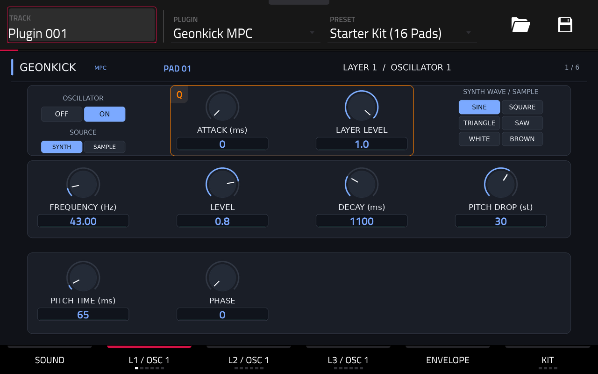
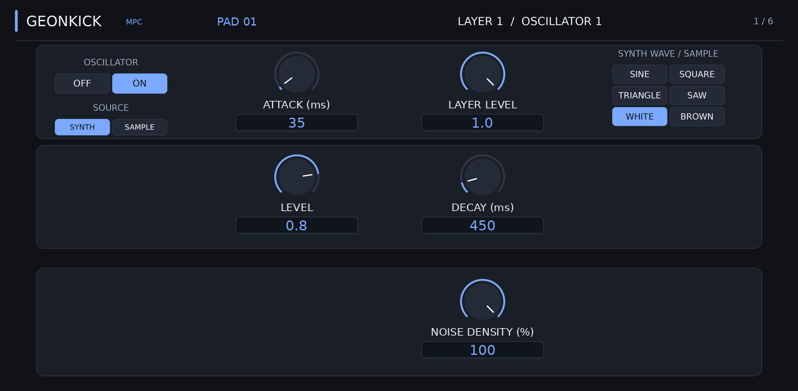

# Geonkick MPC bedienen — 0.0.29

## Native Presets und Kits

Im MPC-Sounds-Browser bzw. nativen Preset-Menü stehen Init, sieben weitere
MPC-Startsounds und „Starter Kit (16 Pads)“ bereit. Zusätzlich gibt es seit0.0.29 die102 originalen
Geonkick-Factory-Sounds und sieben Kits, mit dem Pack-Namen im Browser. Jedes native Preset ersetzt den gesamten
Plugin-Zustand inklusive aller Pads und der MIDI-Zuordnung. Eigene Änderungen
über die MPC-Presetverwaltung speichern; dabei werden auch importierte Samples
und eine gelernte Pad-Zuordnung gespeichert.

Das Starter-Kit nutzt zunächst MIDI-Noten36–51. Falls die Hardware-Pads anders
zugeordnet sind: Wiedergabe stoppen, gewünschte Bank auswählen, unter MASTER →
KIT LEARN16 aktivieren und Pads1–16 der Reihe nach drücken. Anschließend das Kit
als eigenes natives Preset speichern. INIT PAD unter MASTER → KIT setzt nur das
ausgewählte Pad zurück. Native Init setzt dagegen das gesamte Plugin zurück.

## Klangerzeugung (Grundlagen)

Ein Plugin erzeugt einen Drum-Sound aus drei Layern mit je drei Oszillatoren.
Für eine Kick genügt zunächst Layer 1, OSC 1. Layer 2 und 3 starten stumm;
auf ihrer OSC-Seite zuerst LAYER LEVEL anheben, wenn sie hörbar werden sollen.

| Regler | Wirkung |
|---|---|
| FREQUENCY (Hz) | Grundton des Oszillators. Ein Wheel-/Q-Link-Schritt entspricht 5 Cent: bei 55 Hz rund 0,16 Hz, bei 110 Hz rund 0,32 Hz. |
| LEVEL | Lautstärke dieses Oszillators im Layer. |
| LAYER LEVEL | Gemeinsame Lautstärke aller drei Oszillatoren des Layers. |
| ATTACK (ms) | Zeit vom Anschlag bis zur vollen Lautstärke; größer macht den Anfang weicher. |
| DECAY (ms) | Zeit nach dem Attack bis zur Stille; größer lässt den Sound länger ausklingen. |
| PITCH DROP (st) | Startton über dem Grundton in Halbtönen: 12 = eine Oktave. 0 schaltet den Tonhöhenabfall aus. |
| PITCH TIME (ms) | Zeit für den Abfall vom Startton zur FREQUENCY. Kurz erzeugt einen Klick/Punch, lang einen hörbaren Sweep. |
| PHASE | Startposition der periodischen Welle in Grad; beeinflusst den Anschlag und das Zusammenspiel mit anderen Oszillatoren. |
| NOISE DENSITY (%) | Dichte des Rauschens; kleinere Werte machen es lückiger. Nur bei WHITE/BROWN sichtbar. |
| FM → OSC 2 | OSC 1 moduliert die Tonhöhe von OSC 2; erst mit eingeschaltetem OSC 2 verfügbar. OSC 1 ist dann Modulationsquelle statt direktem Audiosignal. |
| LENGTH (ms) | Maximale Länge des gerenderten Sounds. Attack-/Decay-Änderungen verlängern sie bei Bedarf bis 4000 ms. Manuelles Verkürzen schneidet den Ausklang bewusst ab. |
| OUTPUT | Ausgangslautstärke des ganzen Plugins. |

SIN/SINE = weich; SQR/SQUARE = Rechteck; TRI/TRIANGLE = Dreieck;
SAW = Sägezahn; WHT/WHITE und BRN/BROWN = Rauschen.
Bei Rauschen haben Grundfrequenz und Pitch-Sweep keine Funktion; die Detailseite
zeigt dafür NOISE DENSITY. Auf SYNTH steht am Frequenzregler dann NO PITCH.

Auf SYNTH zeigt Grün den fertig berechneten Sound vor OUTPUT, Grau die Hüllkurve
des unter ENVELOPE FOCUS gewählten Oszillators. Attack/Decay wechseln zur
Amplitude, Pitch-Regler zur Pitch-Kurve. Ein anderer Layer/OSC kann auch direkt
oben ausgewählt werden. Die Kurve ist noch kein Editor zum Ziehen von Punkten.

Zum Einstieg: RESET INIT, OSC 1 an, SINE, FREQUENCY etwa 55 Hz, ATTACK 0 ms,
DECAY 300 ms, PITCH DROP 24 st, PITCH TIME 40 ms. Beim Ändern entsteht der neue
Sound im Hintergrund; frisch angeschlagene Noten verwenden den zuletzt fertig
berechneten Stand. Bereits laufende Schläge behalten ihren bisherigen Klang.

L1 OSC1 bezeichnet Layer 1 / Oszillator 1, L1 FX1 dessen Filter und Verzerrer.
OSC FILTER/OSC DRIVE müssen eingeschaltet sein, damit deren Regler hörbar wirken.
CUTOFF bestimmt die Filtergrenze, RESONANCE die Betonung am Filterpunkt. DRIVE
verändert die Verzerrungsstärke, DRIVE OUTPUT deren Ausgangspegel. EFFECTS wirkt
auf die Summe der Layer; die FX-Seiten wirken jeweils nur auf einen Oszillator.

Offline-Vorschauen mit echten Plugin-Werten; keine MPC-Geräteaufnahmen.

Ab 0.0.6 werden OUTPUT-Änderungen kurz geglättet. Ein Wechsel der angezeigten
Hüllkurve berechnet den Sound nicht neu. Neue Klänge entstehen weiterhin im
Hintergrund; bereits laufende Schläge behalten ihren bisherigen Klang.

Ab 0.0.7 pausiert die Kurven-Rückmeldung beim Drehen. Nach etwa 180 ms ohne
weitere Änderung wird die aktuelle Kurve nachgereicht; die normale Anzeige-
Abfrage kann noch etwas Zeit hinzufügen. Der Klang wird während des Drehens
weiter im Hintergrund aktualisiert. Die Kurve wird nicht als Automation aufgezeichnet.

0.0.8 ist ein Testbuild für eine gemeinsame Kurven-Aktualisierung. Bitte prüfen:
Ändert sich die Kurve nach dem Drehen? Stimmt sie nach dem Wechsel zu einer
OSC-Seite und zurück auf SYNTH? Knackt es noch beim Neuzeichnen? Diese Punkte
sind noch nicht auf der MPC bestätigt. Kleine gerundete Eingaben sollen jetzt
auch an bisherigen Sprungstellen bei einem feinen Schritt bleiben.

0.0.9 vergrößert die unsichtbaren Bedienflächen der dünnen Schieberegler.
Die vier Regler direkt unter der Kurve lassen sich bis 24 Pixel oberhalb und
unterhalb des Balkens greifen. Bei engeren Reglern ist der obere Rand kleiner,
damit keine benachbarte Bedienfläche überdeckt wird. Die neue Kurvenmethode
bleibt aktiv und fordert nach dem Drehen einmal das Neueinlesen beim Host an.

0.0.10 behält die funktionierende Kurvenmethode bei. Die feinen Regler folgen
jetzt auch bei längeren Drehbewegungen den einzelnen Eingabeschritten. Bitte
noch einmal langsam und schnell in beide Richtungen prüfen; die großen
Sprünge sollten nicht mehr durch aufgelaufene Eingabewerte entstehen.

0.0.11 trennt die Eingabewege: Touch bewegt den Wert direkt und stufenlos über
den Reglerbereich; Q-Links und Datenrad bleiben für feine Schritte zuständig.
Beide bearbeiten denselben Klangwert. Der Frequenzbereich bleibt beim Touch
musikalisch logarithmisch, die feinen Q-Link-Schritte bleiben 5 Cent.

Ein nativer Punkteditor für Lautstärke/Pitch wurde untersucht, aber noch nicht
implementiert; siehe [Machbarkeit](docs/ENVELOPE-EDITOR.md).

## ENVELOPE: Amp/Pitch mit fünf Punkten (0.0.12)

Layer/Oszillator und AMP oder PITCH wählen, dann POINTS. Beim ersten Wechsel
wird die bisherige einfache Kurve übernommen. Die fünf Kreise lassen sich per
Touch verschieben; alternativ POINT 1–5 auswählen und POINT VALUE bzw.
SEGMENT TIME verwenden. Die Punktbearbeitung läuft nur per Touch, ohne Q-Link-Zuweisungen.
Punkt 1 bleibt bei Zeit null, Punkt 5 am Klangende. LENGTH bestimmt die Gesamtlänge.
Die vier Abschnittszeiten sind relative Gewichte: Ein längerer Abschnitt verkürzt
anteilig die anderen. Beim ersten Punkt zeigt die Zeit START / 0 ms.

SIMPLE schaltet zur bisherigen Hüllkurve zurück. POINTS behält deine Bearbeitung.
COPY SIMPLE ersetzt die Punkte ausdrücklich durch die aktuellen einfachen
Amp-/Pitch-Einstellungen. Änderungen von Attack/Decay bzw. Pitch Drop/Time auf
den anderen Seiten aktivieren wieder SIMPLE für diese Kurve.
Amp-Werte sind Prozent, Pitch-Werte Hz (20 Hz bis maximal 16 × Grundfrequenz,
begrenzt auf 20 kHz). Die Grundfrequenz skaliert die eigene Pitch-Kurve mit.
Punkte werden im Projekt gespeichert. Freies Hinzufügen/Löschen und Bezier
folgen später. Das zweidimensionale Verschieben der Punkte wurde auf der MPC bestätigt.
Ab 0.0.13 bleibt die Wellenform des gesamten gemischten Klangs direkt hinter
den grünen Hüllkurvenpunkten sichtbar. Sie zeigt den zuletzt fertig berechneten
Klang und aktualisiert sich nach einer kurzen Bedienpause. Die Kurve darüber
gehört zum ausgewählten Oszillator (AMP/PITCH). Nur LENGTH behält auf diesem
Reiter einen Q-Link; Punktwahl, Punktwerte und Copy Simple sind Touch-Bedienung.
