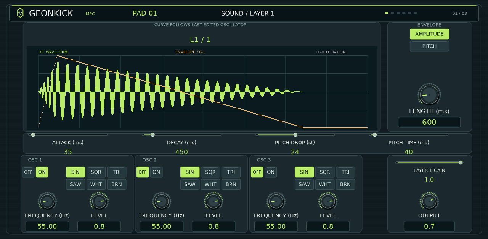

# Geonkick MPC

The MPC adapter, build scripts and interface are AI-generated. The user has tested early builds on Live III and reported interface and control
problems. The user confirmed that 0.0.9 redraws the curve and the tested redraw actions
no longer crackle on Live III. Version 0.0.10 follows the actual accumulated
wheel/Q-Link input stream to address the remaining jumps. Its fine-control
hardware acceptance is **pending**; the working graph/touch design is retained. The original Geonkick DSP is the
work of Iurie Nistor and contributors, not AI-generated.

Development port of [Geonkick 3.9.0](https://github.com/quamplex/geonkick) for
Gen2 MPCs (aarch64), targeting MPC OS 3.10.1+. Version 0.0.10 is a playable
single-instrument prototype, not the complete desktop application.

Implemented:

- Three synthesis layers, three oscillators per layer; independent oscillator
  enable, waveform, frequency, level, phase, noise density, attack and decay.
- Sine, square, triangle, saw, white noise and Brownian noise.
- Fine frequency control in 5-cent wheel/Q-Link steps (about 0.16 Hz at 55 Hz),
  with physical Hz displayed to two decimals. Existing saved Hz values and
  linear-frequency automation retain their meaning.
- Explicit millisecond timing; changing attack/decay extends sound length when
  required. Deliberately cropped long envelopes keep their correct slopes.
- Conditional noise/tone controls, visible layer level on oscillator pages and
  captions contained inside their controls to prevent duplicate/ghost text.
- Pitch-drop amount and time; first-oscillator FM into the second per layer,
  matching the original engine's routing.
- Global and per-oscillator low/high/band-pass filters and nine original
  distortion modes. Each oscillator has an independent drive/output stage.
- Eight voices, velocity, optional note tracking, tuning, poly/cut/gate playback.
- Eight starting sounds: Init, Deep Kick, Tight Kick, Snare, Closed Hat,
  Open Hat, Metal and Tom. Native VST program bank for MPC's preset browser.
- Native MPC pages and Q-Links, per-layer oscillator subpages, Sounds-browser
  artwork and an Init .xpl. Frames include complete label and value bounds.
- Sharper 0.0.4 display: 432 two-pixel waveform columns, pixel-height waveform
  levels, finer envelope steps, native-size live values and crisp page captions.
- Visual SYNTH page: green waveform of the actual completed sound, gray
  amplitude/pitch envelope of a selected oscillator, and three oscillator
  modules beneath it. Attack, decay, pitch drop and pitch time can be changed
  beside the graph. Layer subpages expose their layer gain; MIX holds global
  playback/tuning controls. The palette follows the original gray/green design.
- Versioned project state with 186 stored controls, plus derived read-only
  graph/view channels. Original indices stay unchanged. 0.0.1 and 0.0.2 chunks
  load with the appended controls at neutral/default values.
- Graph refresh uses one derived revision signal instead of per-column host
  notifications; the skin binds each graph widget to that invalidation handle.
  The native repaint path remains experimental: a post-gesture host rebind now
  follows that signal. No column callback burst is reintroduced.
- Thin sliders retain their original visible pixels with transparent padded
  native hit areas (64 pixels high for the main envelope sliders).
- Fine controls track consecutive raw input deltas, including long accumulated
  wheel/Q-Link streams, reversals and clamped endpoints. This prevents distance
  from the accepted value growing into an unintended absolute jump.
- Rounded small movements remain one fine step even at exact integer boundaries;
  fine unit controls disable the native coarse-wheel mode.
- Derived graph/view values are non-automatable. Curve feedback waits until
  180 ms after the last parameter edit; normal control feedback stays active.
  Synthesis requests are coalesced to about 30 starts/second, with completed
  intermediate sounds published during continuous edits.
- Audio-side UI notifications are queued to a normal-priority display thread;
  view changes reuse rendered audio, silent layers are skipped, playback-only
  edits skip synthesis, and
  OUTPUT changes are smoothed. A deliberately blocked UI host is regression-tested.
- Per-instance worker generates sound buffers; audio playback neither allocates
  nor waits for synthesis. Existing hits retain their old sound during edits.

Offline preview of the built skin with values queried from the compiled native
VST (edited Init, 35 ms attack). This is not a device screenshot.
See [BEDIENUNG.md](BEDIENUNG.md) for a German control guide and
[UI-DESIGN.md](UI-DESIGN.md) for the visualization and editing limits.

Editing a sound is asynchronous: new notes use the latest **completed** sound.
During rapid changes they may briefly use the preceding one. Output, tuning,
note tracking and playback mode apply at playback; layers/filter/oscillators are
rendered into the sound. Layer 1 is audible by default; layers 2 and 3 start at
zero gain. On the PRESETS page, RESET INIT restores Init even if Init is already
the selected preset; selecting the same preset value alone does not reload it.

First-prototype limits: one drum per instance and stereo output, no 16-drum kit
editor, sample import, arbitrary graphical envelope editor or humanizer.
Amp and pitch envelopes are generated from attack/decay and pitch-time controls.
The graph is a display, not a draggable point editor. It depicts the completed
single-hit buffer before output gain, not a real-time oscilloscope of playing
voices; the gray envelope is normalized independently to 0–1. The view updates
after synthesis completes, with host notifications on a separate 100 ms display
thread rather than on the audio thread. Native display behavior and performance
still need confirmation on a real MPC; the source desktop GUI is not embedded.
Pink noise is omitted because the pinned
upstream implementation returns zero. The original state-variable filter is
restricted to 30–8000 Hz and resonance 10–1000 to keep its discrete-time update
stable at the MPC engine's 44.1 kHz. This needs revisiting for full parity.

See [LICENSE-AUDIT.md](LICENSE-AUDIT.md), [BUILDING.md](BUILDING.md), [TESTING.md](TESTING.md),
[ROADMAP.md](ROADMAP.md) and [source provenance](src/VENDORED.md).
Installer ZIPs are local development artifacts; no public GitHub repository,
release or store listing has been created for this port yet.
Product name: **Geonkick MPC**; the prepared catalog JSON uses **GeonKick**.

License: **GPL-3.0-or-later**, including vendored Geonkick and Quamplex DSP Tools.
The external OpenMPC wrapper is MIT; the bundled DejaVu font has its own notice
in art/FONT-LICENSE.txt. No Akai stock artwork or proprietary SDK is included.
