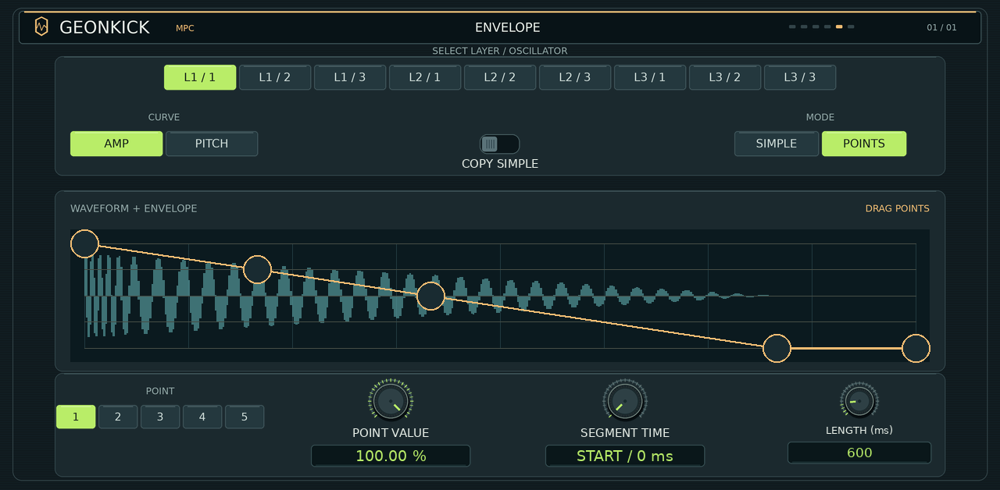
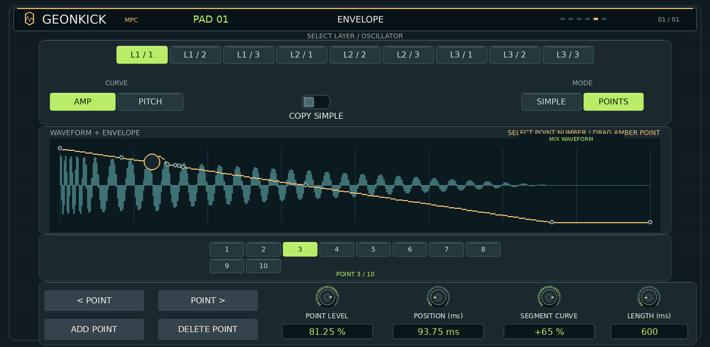
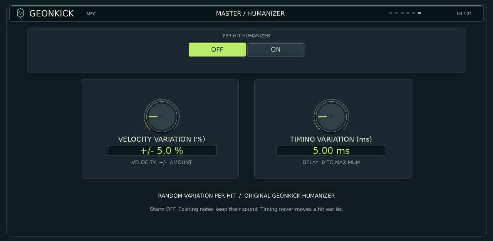

# Geonkick MPC

The MPC adapter, build scripts and interface are AI-generated. The user has tested early builds on Live III and reported interface and control
problems. The user confirmed the real value jumps are resolved in 0.0.10; a brief
visual knob rebound remained. Version 0.0.11 separates direct continuous Touch
handles from fine Q-Link/data-wheel handles on the same physical parameter.
The user confirmed the 0.0.11 changes work. The user confirmed that0.0.12 point handles can be dragged in two dimensions
and later reported the corrected0.0.18 build working; its installed version
was verified read-only before the0.0.19 update.
Version 0.0.13 adds the completed sound waveform behind those handles and removes
point-editing Q-Link assignments; the combined view still needs device acceptance. The original Geonkick DSP is the
work of Iurie Nistor and contributors, not AI-generated.

Development port of [Geonkick 3.9.0](https://github.com/quamplex/geonkick) for
Gen2 MPCs (aarch64), targeting MPC OS 3.10.1+. Version 0.0.20 is a playable
single-instrument prototype, not the complete desktop application.

Since 0.0.14 the interface is organized into six menu keys: SOUND, LAYER1–3,
ENVELOPE and MASTER. Each layer alternates OSC1/FX1, OSC2/FX2, OSC3/FX3. MASTER
contains MIX, global FX and PRESETS; the point editor has its own key. Q-Links
control rotary knobs only; switches, selectors, sliders and point editing remain
touch-only. The historical MIDI CC table and all parameter/state IDs are retained.
Native/ARM64 and isolated Live III signal-boundary tests pass; actual on-device
menu and listening acceptance for this candidate remains pending.

0.0.15 adds the original **Percussion Lab** design: graphite panels, machined
rotary strips, recessed native value backgrounds, rounded selectors, green hit
waveforms and amber envelopes. Page/layer indicators and the Sounds tile share
the same geometric percussion mark. Native gestures, input bounds, Q-Link maps,
all parameters and the 0.0.14 audio remain unchanged. On-device visual acceptance
is pending; previews below are offline renders.

0.0.16 fixes oscillator-focus snapback after native host feedback and centres
all eight MASTER/PRESETS buttons inside their panel. Native sanitizer, ARM64 and
new host-echo/geometry regressions pass; actual MPC touch acceptance is pending.

0.0.17 adds **variable Amp/Pitch envelopes with 2–16 points** on every oscillator.
ADD POINT divides the selected outgoing segment without changing its cubic shape;
DELETE POINT removes an interior point. The full envelope and completed mixed-hit
waveform remain visible together. Native XY editing uses the same full-hit coordinates as the curve. All points
are visible; choose a point number or POINT previous/next, then drag the amber
puck. The five-grip native Pitch editor used in0.0.17 was removed after hardware
screenshots exposed incompatible stage spacing. POINT
LEVEL and POSITION edit the selection; SEGMENT CURVE bends its outgoing cubic
Bezier segment. All point editing is touch-only. First/last times stay at the
sound boundaries. This is a local development build; new MPC touch acceptance
is pending. The build was installed under renewed standing permission and the
MPC application restarted; no formal Store benchmark has been performed.

Short-hit ends now use a smooth 5 ms tail. Cut retriggers and stolen voices
continue the old waveform through a bounded 5 ms fade while the new hit starts
immediately. Panic still silences all voices/tails immediately. No audio-side
allocation, synthesis wait or UI callbacks are introduced.

Implemented:

- Three synthesis layers, three oscillators per layer; independent oscillator
  enable, waveform, frequency, level, phase, noise density, attack and decay.
- Sine, square, triangle, saw, white noise and Brownian noise.
- Fine frequency control in 5-cent wheel/Q-Link steps (about 0.16 Hz at 55 Hz),
  with physical Hz displayed to two decimals. Existing saved Hz values and
  linear-frequency automation retain their meaning.
- Explicit millisecond timing; changing attack/decay extends sound length when
  required. Deliberately cropped long envelopes keep their correct slopes.
- Conditional noise/tone controls, visible layer level on oscillator pages and
  captions contained inside their controls to prevent duplicate/ghost text.
- Pitch-drop amount and time; first-oscillator FM into the second per layer,
  matching the original engine's routing.
- Global and per-oscillator low/high/band-pass filters and nine original
  distortion modes. Each oscillator has an independent drive/output stage.
- Eight voices, velocity, optional note tracking, tuning, poly/cut/gate playback.
- Eight starting sounds: Init, Deep Kick, Tight Kick, Snare, Closed Hat,
  Open Hat, Metal and Tom. Native VST program bank for MPC's preset browser.
- Native MPC pages and Q-Links, per-layer oscillator subpages, Sounds-browser
  artwork and an Init .xpl. Frames include complete label and value bounds.
- Sharper 0.0.4 display: 432 two-pixel waveform columns, pixel-height waveform
  levels, finer envelope steps, native-size live values and crisp page captions.
- Visual SYNTH page: green waveform of the actual completed sound, amber
  amplitude/pitch envelope of a selected oscillator, and three oscillator
  modules beneath it. Attack, decay, pitch drop and pitch time can be changed
  beside the graph. Layer subpages expose their layer gain; MIX holds global
  playback/tuning controls. The 0.0.15 Percussion Lab palette uses graphite, lime and amber.
- Versioned GKMP7 project state with 1554 stored values, including independent
  point lists and Bezier ordinates for all 18 curves. All 3040 previous VST
  parameter identities remain unchanged. GKMP1–6 states migrate with their
  original sound and old five-point data; variable editing converts them lazily.
  Full 16-point states are tested through the actual VST chunk API.
- Graph refresh uses one derived revision signal instead of per-column host
  notifications; the skin binds each graph widget to that invalidation handle.
  The native repaint path remains experimental: a post-gesture host rebind now
  follows that signal. No column callback burst is reintroduced.
- Thin sliders retain their original visible pixels with transparent padded
  native hit areas (64 pixels high for the main envelope sliders).
- Native ENVELOPE page: 2–16 points for Amp and Pitch on all nine oscillators,
  Simple/Points and Copy Simple, cubic segment curvature, 36-pixel touch grips,
  previous/next selection and complete curve/waveform overlay. No point Q-Links.
  Original five-point dragging was confirmed on MPC; the new variable grip groups
  require separate hardware validation. See [editor guide](docs/ENVELOPE-EDITOR.md).
- Touch gestures use independent continuous handles for all 46 fine controls.
  Q-Link/data-wheel selection and mapping stay fine; both routes share saved
  physical values. The visible knob follows the direct Touch value, avoiding
  the raw-fine-input/accepted-value normalization bounce.
- Fine controls track consecutive raw input deltas, including long accumulated
  wheel/Q-Link streams, reversals and clamped endpoints. This prevents distance
  from the accepted value growing into an unintended absolute jump.
- Rounded small movements remain one fine step even at exact integer boundaries;
  fine unit controls disable the native coarse-wheel mode.
- Derived graph/view values are non-automatable. Curve feedback waits until
  180 ms after the last parameter edit; normal control feedback stays active.
  Synthesis requests are coalesced to about 30 starts/second, with completed
  intermediate sounds published during continuous edits.
- Audio-side UI notifications are queued to a normal-priority display thread;
  view changes reuse rendered audio, silent layers are skipped, playback-only
  edits skip synthesis, and
  OUTPUT changes are smoothed. A deliberately blocked UI host is regression-tested.
- Per-instance worker generates sound buffers; audio playback neither allocates
  nor waits for synthesis. Existing hits retain their old sound during edits.

Offline preview of the built skin with values queried from the compiled native
VST (edited Init, 35 ms attack). This is not a device screenshot.

Point-editor layout preview uses actual VST values with an approximation of
the native Envelope geometry. The user confirmed dragging in 0.0.12; combined
waveform/curve geometry and redraw performance still require acceptance.

See [BEDIENUNG.md](BEDIENUNG.md) for a German control guide and
[UI-DESIGN.md](UI-DESIGN.md) for the visualization and editing limits.

Editing a sound is asynchronous: new notes use the latest **completed** sound.
During rapid changes they may briefly use the preceding one. Output, tuning,
note tracking and playback mode apply at playback; layers/filter/oscillators are
rendered into the sound. Layer 1 is audible by default; layers 2 and 3 start at
zero gain. On the PRESETS page, RESET INIT restores Init even if Init is already
the selected preset; selecting the same preset value alone does not reload it.

First-prototype limits: one drum per instance and stereo output, no 16-drum kit
editor, sample import or original preset interchange. Amp/Pitch support2–16
points, insertion/deletion, cubic curvature and absolute XY editing over the
waveform. Free Bezier control handles and arbitrary tap-to-insert are pending.
The Humanizer is available from0.0.20. The SYNTH graph displays the completed sound. It depicts the completed
single-hit buffer before output gain, not a real-time oscilloscope of playing
voices; the amber envelope is normalized independently to 0–1. The view updates
after synthesis completes, with host notifications on a separate 100 ms display
thread rather than on the audio thread. Native display behavior and performance
still need confirmation on a real MPC; the source desktop GUI is not embedded.
Pink noise is omitted because the pinned
upstream implementation returns zero. The CLASSIC state-variable filter retains its original30–8000 Hz /10–1000
controls.0.0.19 adds WIDE20 Hz–20 kHz filtering with bounded Q0.5–20, a normalized
resonance percentage and fine hardware / direct Touch cutoff and resonance.
Older GKMP1–5 projects load CLASSIC automatically; new Init instances use WIDE.
The two starting hat sounds retain CLASSIC so their existing sound is unchanged.
See [filter guide](docs/FILTERS.md).

Point-editor feasibility and limits: [ENVELOPE-EDITOR.md](docs/ENVELOPE-EDITOR.md).

See [LICENSE-AUDIT.md](LICENSE-AUDIT.md), [BUILDING.md](BUILDING.md), [TESTING.md](TESTING.md),
[ROADMAP.md](ROADMAP.md) and [source provenance](src/VENDORED.md).
Installer ZIPs are local development artifacts; no public GitHub repository,
release or store listing has been created for this port yet.
Product name: **Geonkick MPC**; the prepared catalog JSON uses **GeonKick**.

License: **GPL-3.0-or-later**, including vendored Geonkick and Quamplex DSP Tools.
The external OpenMPC wrapper is MIT; the bundled DejaVu font has its own notice
in art/FONT-LICENSE.txt. No Akai stock artwork or proprietary SDK is included.

The 0.0.17 native/ASan/UBSan/leak and actual ARM64 shared-library/QEMU suites
pass. Cubic insertion audio differs by less than 1e-7 in the regression fixture;
this is numerical verification, not a CPU benchmark or a hardware hearing claim.
See [the focused MPC test guide](TESTPLAN-0.0.18-DE.md) for the next device test.

0.0.18 corrects the hardware-reported envelope/handle alignment using native
absolute XY positions. Only existing point numbers are shown, all points use
readonly small markers, and the selected point uses an amber draggable marker.
A normal-priority idle action reset clears point buttons even when MPC is
stopped, including a debounced second high event from finger release. Point
selection/status now notify the host without waiting for synthesis. Hardware
interaction acceptance remains required. Existing sound/state/Q-Link behavior
and quiet-time waveform feedback remain in place.

0.0.19 adds independent **CLASSIC / WIDE** selection to MASTER/FX and all nine
oscillator FX pages. WIDE uses a stable trapezoidal state-variable filter with
cached coefficients,20 Hz–20 kHz cutoff and Q0.5–20. Q-Links step cutoff in5 cents
and resonance in0.1%; Touch sweeps continuously. Old normalized automation ranges
and all previous VST identities are retained. Thirty actual0.0.18-vs-current old
project fixtures produce identical audio in the ARM64 regression. Tests are
functional checks, not a formal Store benchmark. New filter hardware/hearing
acceptance remains required; see [0.0.19 test guide](TESTPLAN-0.0.19-DE.md).

0.0.19 is installed on the user's Live III under renewed standing update
permission. Plugin files and binary checksum were verified, the previous folder
was backed up locally, and the MPC application restarted active/running.
New cutoff/resonance hearing and Touch acceptance remain pending; no formal
Store CPU benchmark has been performed for this development binary.

0.0.20 adds the original **Humanizer** under MASTER → HUMANIZER: optional
velocity variation0–30% and positive timing variation0–30ms. It starts OFF.
Only the two knobs have Q-Links; Touch is continuous and hardware input is fine.
The native page has the same Percussion Lab design. Timing uses a bounded
sample scheduler with pinned sound caches, not sleeps or per-hit synthesis;
Gate/Panic/reset cancel pending notes and Cut occurs at the randomized onset.
See [Humanizer guide](docs/HUMANIZER.md) and [test plan](TESTPLAN-0.0.20-DE.md).
New hardware acceptance is still required; no Store benchmark is claimed.

0.0.20 was installed under standing plugin-update permission; plugin hashes and
running MPC application were verified. Humanizer hearing/Touch acceptance on
Live III remains pending. The user confirmed the preceding0.0.19 filter build.
