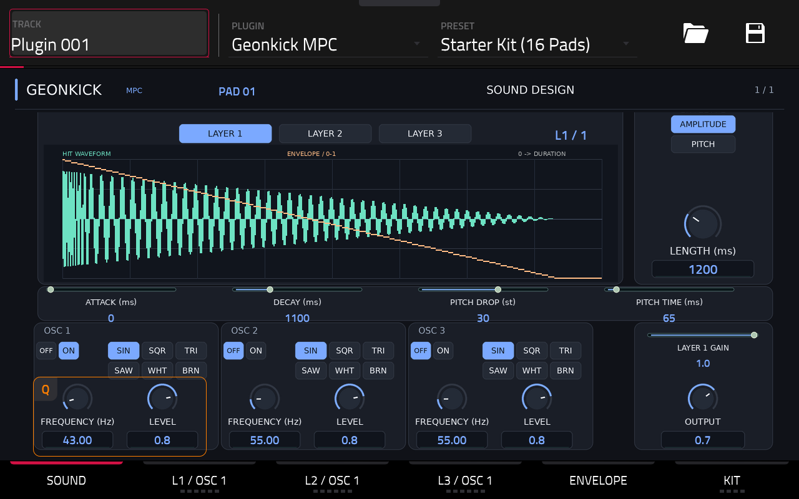
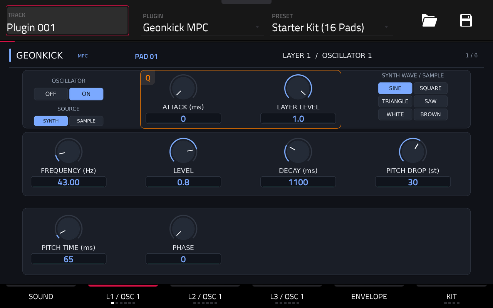
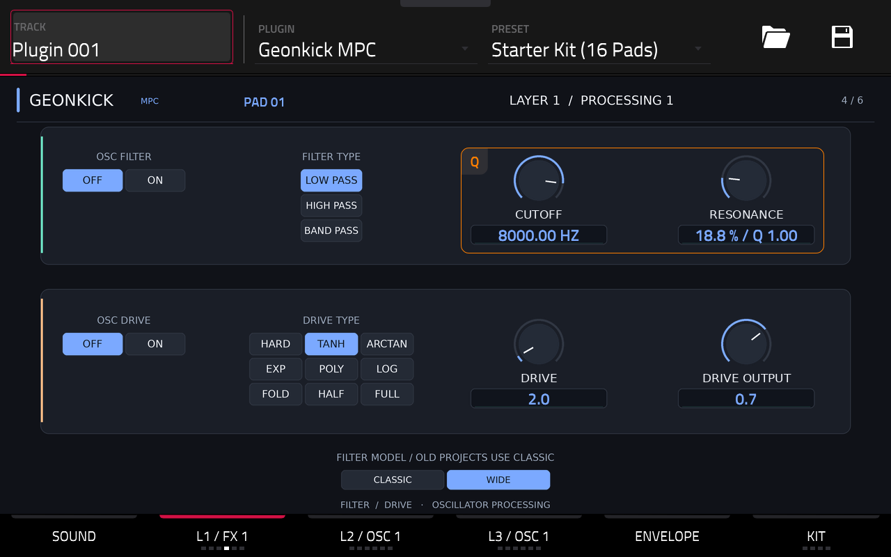
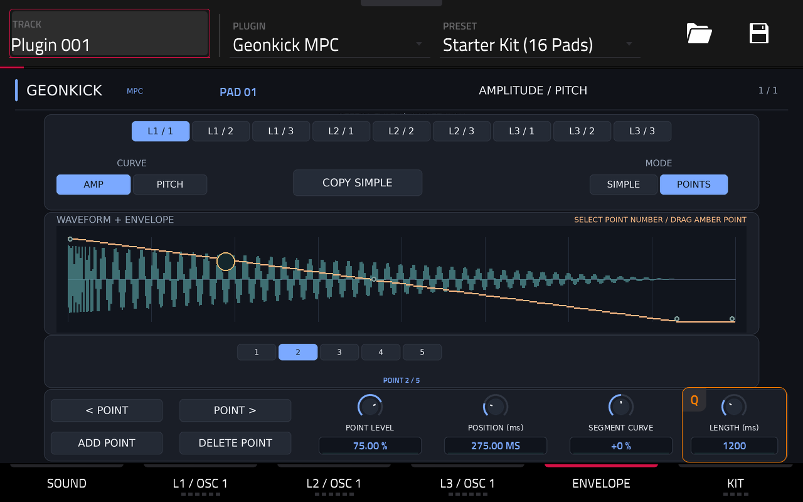
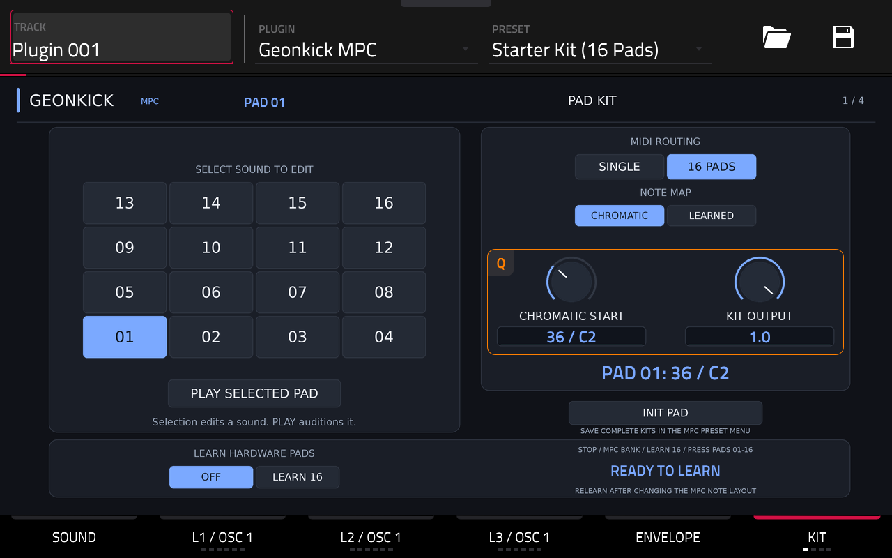
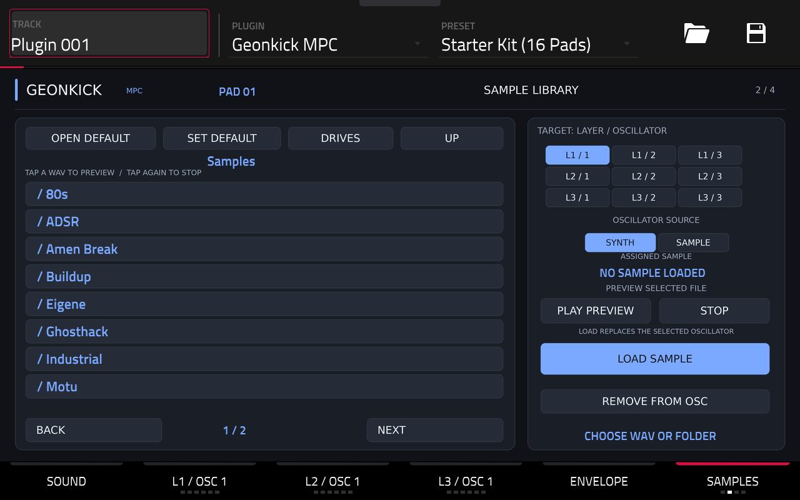

# Geonkick MPC — on the MPC

Actual MPC Live III captures supplied by the maintainer. Captured during the final 1.0 development cycle; these are not mockups. Only selected interface captures are published, with no embedded text/location/device metadata.

## Sound overview

## Oscillator controls

## Oscillator effects

## Envelope editing

## Pad kit

## Sample browser

The sample folders shown are the maintainer's browser view. Their contents are not included in the release; bundled factory sounds have their own documented licences.
